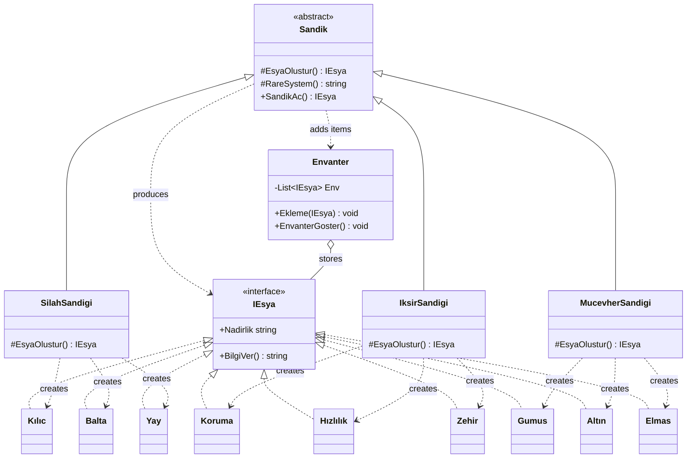

# Factory Method Pattern — Dungeon Loot System

## Fikir Nereden Çıktı?

Factory Method desenini öğrendikten sonra, Singleton projemde olduğu gibi bu kez de klasik örneklerin dışında bir şey geliştirmek istedim.

Aklıma RPG oyunlarında sıkça karşılaştığımız hazine sandıkları geldi. Oyuncu bir sandığı açtığında içinden ne çıkacağını bilmiyor. Üstelik her sandığın verebileceği eşyalar da farklı. Bir silah sandığından kılıç çıkabilirken, iksir sandığından farklı etkilere sahip iksirler çıkabiliyor.

Buradan yola çıkarak, **her sandığın kendi türüne uygun rastgele bir eşya ürettiği küçük bir Dungeon Loot System** geliştirmeye karar verdim.

Factory Method'un bu senaryoya uygun olduğunu düşündüm çünkü bütün sandıklar aynı açılma sürecini paylaşırken, hangi eşyanın oluşturulacağına kendi sınıfları karar veriyor.

## Factory Method'u Nasıl Kullandım?

Uygulamanın merkezinde `Sandik` isimli abstract sınıf bulunuyor.

Bu sınıfta iki önemli metot var:

- `EsyaOlustur()`: Factory Method. Hangi somut eşyanın oluşturulacağını alt sınıflara bırakıyor.
- `SandikAc()`: Ortak sandık açma işlemini gerçekleştiriyor, oluşturulan eşyanın bilgilerini gösteriyor ve envantere ekliyor.

`SilahSandigi`, `IksirSandigi` ve `MucevherSandigi` sınıfları `Sandik` sınıfından miras alarak `EsyaOlustur()` metodunu kendi ihtiyaçlarına göre uyguluyor.

Böylece ortak sandık açma kodunu her sınıfta tekrar yazmam gerekmiyor. Ayrıca üst sınıf, hangi somut eşyanın üretileceğini bilmek zorunda kalmıyor.

Bu projede yalnızca bir `switch` üzerinden nesne oluşturan Simple Factory yaklaşımını değil, **GoF Factory Method desenindeki Creator ve ConcreteCreator yapısını** kullandım.

## Sandıklar ve Eşyalar

Projede 3 sandık türü ve toplam 9 farklı eşya bulunuyor.

| Sandık | Üretebildiği eşyalar |
|---|---|
| Silah Sandığı | Demir Kılıç, Demir Balta, Elf Yayı |
| İksir Sandığı | Koruma İksiri, Hızlandırma İksiri, Zehirli İksir |
| Mücevher Sandığı | Gümüş, Altın, Elmas |

Her eşyanın kendine ait bir özelliği bulunuyor. Silahlar hasar gücü, iksirler farklı etkiler, mücevherler ise mevcut simülasyonda iyileştirme gücü bilgisi taşıyor.

### Rastgele Eşya ve Nadirlik Sistemi

Sandık açıldığında `RareSystem()` metodu kullanılarak rastgele bir seçim yapılıyor.

Sistemde üç nadirlik seviyesi bulunuyor:

- `Rare`
- `Epic`
- `Legendary`

Her somut eşya sınıfının ayrıca kendisine ait bir `Nadirlik` özelliği var.

Bu şekilde sandıktan çıkan eşyanın adı, özelliği ve nadirlik bilgisi hem sandık açılırken hem de envanter görüntülenirken kullanılabiliyor.

## Proje Yapısı

| Dosya | Görevi |
|---|---|
| `Product.cs` | Ortak `IEsya` interface'ini tanımlar. |
| `ConcreteProduct.cs` | Dokuz farklı eşyanın somut sınıflarını içerir. |
| `Creator.cs` | Abstract `Sandik` sınıfını, Factory Method'u ve ortak açılma işlemini içerir. |
| `ConcreteCreator.cs` | Üç farklı sandığın eşya üretme davranışını belirler. |
| `Envanter.cs` | Açılan sandıklardan kazanılan eşyaları saklar ve listeler. |
| `Program.cs` | Konsol menüsünü ve kullanıcı seçimlerini yönetir. |

## UML Sınıf Diyagramı

Factory Method'un sınıflar arasındaki ilişkisini daha anlaşılır göstermek için aşağıdaki diyagramı hazırladım.



Bu diyagramdaki Factory Method karşılıkları:

| Tasarım deseni kavramı | Projedeki karşılığı |
|---|---|
| Product | `IEsya` |
| ConcreteProduct | `Kılıc`, `Balta`, `Yay` ve diğer eşya sınıfları |
| Creator | `Sandik` |
| ConcreteCreator | `SilahSandigi`, `IksirSandigi`, `MucevherSandigi` |
| FactoryMethod() | `EsyaOlustur()` |
| AnOperation() | `SandikAc()` |

## Uygulama Nasıl Çalışıyor?

Kullanıcı konsol üzerinden üç farklı sandıktan birini seçebiliyor.

Bir sandık açıldığında ilgili ConcreteCreator, kendi `EsyaOlustur()` metoduyla rastgele bir eşya üretiyor. Ardından eşyanın bilgileri ekrana yazdırılıyor ve eşya envantere kaydediliyor.

Oyuncu birden fazla sandık açabiliyor ve kazandığı eşyaları envanter bölümünden görüntüleyebiliyor.

### Örnek Konsol Çıktısı

```text
===== DUNGEON LOOT SYSTEM =====

1 - Silah Sandığı Aç
2 - İksir Sandığı Aç
3 - Mücevher Sandığı Aç
4 - Envanterimi Göster
0 - Çıkış

Seçiminiz: 1

Elf Yayı - Hasar Gücü - 50 - Nadirlik: Legendary
Ürün envantere eklendi

Seçiminiz: 3

Altın - İyileştirme Gücü - 25 - Nadirlik: Epic
Ürün envantere eklendi

Seçiminiz: 4

Elf Yayı - Hasar Gücü - 50 - Nadirlik: Legendary
Altın - İyileştirme Gücü - 25 - Nadirlik: Epic
```

*Çıkan eşyalar rastgele belirlendiği için sonuçlar her çalıştırmada farklı olabilir.*

## Çalıştırma

Bilgisayarınızda .NET 10 SDK kuruluysa proje klasöründe aşağıdaki komutu çalıştırmanız yeterli:

```bash
dotnet run
```

## Bu Projede Ne Öğrendim?

Bu projeyi geliştirirken Factory Method'un neden yalnızca nesne oluşturan bir metottan ibaret olmadığını daha iyi anladım.

Özellikle `abstract`, `override`, interface ve polymorphism kavramlarının birlikte nasıl çalıştığını görmek benim için faydalı oldu.

Aynı `SandikAc()` metodunu kullanarak farklı türde eşyalar oluşturabilmek, nesne oluşturma sorumluluğunu alt sınıflara bırakmanın ne işe yaradığını somutlaştırdı.

Factory Method dışında rastgele seçim, koleksiyonlar, özellikler (properties) ve konsol tabanlı kullanıcı etkileşimi konusunda da pratik yapmış oldum.

## Küçük Bir Not

Bu proje tam kapsamlı bir RPG oyunu değil. **Factory Method tasarım desenini daha gerçekçi ve eğlenceli bir senaryoda öğrenmek amacıyla geliştirdiğim küçük bir eşya üretim simülasyonu.**

Buradaki temel amacım, tasarım desenlerini hazır örneklerden ezberlemek yerine kendi oluşturduğum senaryolar üzerinde uygulamak ve öğrendiklerimi başkalarıyla paylaşmak.