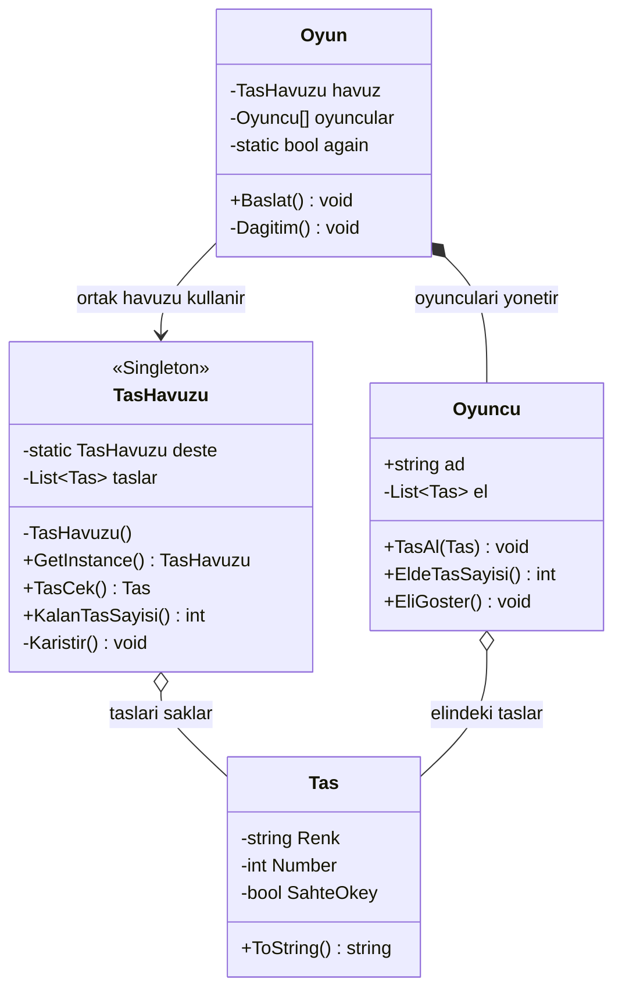

# Singleton Pattern — 101 Okey Taş Havuzu

## Fikir Nereden Çıktı?

Singleton desenini öğrendikten sonra, bu deseni kendi düşündüğüm bir örnekte nasıl kullanabileceğimi araştırmaya başladım.

Aklıma 101 Okey geldi. Çünkü tek bir oyun masasında dört oyuncu bulunmasına rağmen herkes aynı taş havuzunu kullanıyor. Her oyuncunun kendine ait ayrı bir taş destesi oluşturması oyunun mantığına aykırı olurdu.

Ben de bu ortak havuzu **Singleton tasarım deseniyle** yönetmenin iyi bir örnek olacağını düşündüm.

Böylece yalnızca `GetInstance()` metodunun nasıl çalıştığını gösteren bir örnek yerine, Singleton'ın bir uygulamada hangi sorunu çözebileceğini gösteren küçük bir simülasyon geliştirdim.

## Singleton'ı Nasıl Kullandım?

Uygulamanın merkezinde `TasHavuzu` sınıfı bulunuyor.

Bu sınıf:

- Başlangıçta 106 Okey taşını oluşturuyor.
- Taşları Fisher–Yates algoritmasıyla karıştırıyor.
- Oyuncuların ortak havuzdan taş çekmesini sağlıyor.
- Havuzda kalan taş sayısını takip ediyor.

Singleton yapısını kurmak için constructor'ı `private` tanımladım ve tek nesneye `static GetInstance()` metodu üzerinden erişilmesini sağladım.

Böylece uygulama içerisinde farklı referanslardan havuza erişilse bile aynı nesne kullanılıyor.

## Proje Yapısı

| Dosya | Görevi |
|---|---|
| `Tas.cs` | Bir taşın rengini, numarasını ve sahte okey bilgisini tutar. |
| `TasHavuzu.cs` | Singleton desenini uygular; taşları oluşturur, karıştırır ve yönetir. |
| `Oyuncu.cs` | Oyuncunun adını ve elindeki taşları saklar. |
| `Oyun.cs` | Oyuncuları oluşturur, taş dağıtımını ve oyun başlangıcını yönetir. |
| `Program.cs` | Uygulamayı başlatır. |

## UML Sınıf Diyagramı

Projeyi geliştirirken sınıfların sorumluluklarını birbirinden ayırmaya çalıştım. Singleton deseni `TasHavuzu` sınıfında uygulanırken, oyun yönetimi ve oyuncuların elleri farklı sınıflarda tutuluyor.

Aşağıdaki diyagramda projenin sınıf yapısı ve sınıflar arasındaki ilişkiler gösteriliyor.



*Diyagramda bazı Türkçe metot isimleri gösterim kolaylığı açısından sadeleştirilmiştir.*

## Uygulama Nasıl Çalışıyor?

Oyun başladığında 104 normal taş ve 2 sahte okeyden oluşan toplam 106 taşlık havuz hazırlanıyor.

Taşlar karıştırıldıktan sonra dört oyuncuya dağıtılıyor:

- Başlayan oyuncuya 22 taş
- Diğer üç oyuncuya 21'er taş

Dağıtımın sonunda her oyuncunun elindeki taşlar ve havuzda kalan 21 taşın sayısı konsola yazdırılıyor.

Oyuncular aynı havuza eriştiği için bir taş çekildiğinde kalan taş sayısı bütün referanslar açısından güncellenmiş oluyor.

Uygulama tek oyun oturumu için tasarlandığından, oyun ikinci kez başlatılmaya çalışıldığında yeniden taş dağıtılması engelleniyor.

### Çalıştırma

Bilgisayarınızda .NET SDK kuruluysa proje klasöründe aşağıdaki komutu çalıştırmanız yeterli:

```bash
dotnet run
```

### Örnek Konsol Çıktısı

```text
Ahmet
-----------------
Kırmızı 7
Mavi 12
Siyah 3
...
-----------------
Toplam Taş: 22
-----------------

Mehmet
-----------------
Sarı 5
Kırmızı 11
Mavi 2
...
-----------------
Toplam Taş: 21
-----------------

...

Havuzda Kalan Taş: 21
```

*Taşlar rastgele karıştırıldığı için her çalıştırmada oyunculara dağıtılan taşlar değişebilir.*

## Bu Projede Ne Öğrendim?

Singleton'ın yalnızca tek bir nesne oluşturmakla ilgili olmadığını, uygulama genelinde ortak bir durumu yönetmek için de kullanılabileceğini gördüm.

Ayrıca sınıfların sorumluluklarını ayırmanın önemini daha iyi anladım. Taşların bilgilerini, taş havuzunu, oyuncuları ve oyun yönetimini farklı sınıflarda ele almak kodun daha anlaşılır olmasını sağladı.

Bu projede Singleton dışında `List<T>`, nesne yönelimli programlama, constructor kullanımı, kapsülleme ve Fisher–Yates karıştırma algoritması üzerinde de pratik yapmış oldum.

## Küçük Bir Not

Bu proje, 101 Okey'in bütün kurallarını içeren oynanabilir bir oyun değil. Özellikle **Singleton deseninin kullanımını göstermek amacıyla hazırlanmış, tek masalık ve tek oturumluk bir taş dağıtım simülasyonu**.

Birden fazla bağımsız oyun masası desteklenecek olsaydı her masanın kendi taş havuzuna ihtiyacı olacağından, mevcut Singleton yaklaşımını yeniden değerlendirmek gerekirdi.

Asıl amaç, bir tasarım desenini ezberlemek yerine neden ve nerede kullanabileceğimi anlamaktı.