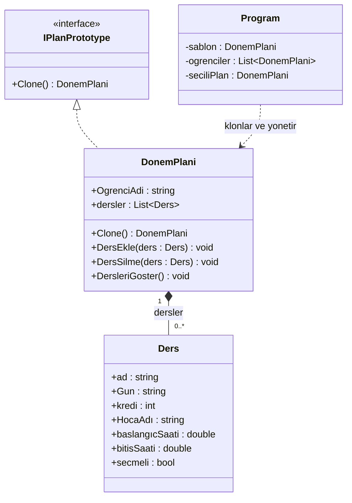

# SemesterClone — Kişisel Ders Programı Oluşturucu

**Tasarım deseni:** Prototype  
**Dil:** C# (.NET 10)  
**Uygulama:** Konsol

## Proje hakkında

Bu projeyi Tasarım Desenleri dersinde öğrendiğim **Prototype Pattern**'i gerçek bir senaryo üzerinde uygulamak için geliştirdim.

Fikir basit: Üniversitede aynı bölümde okuyan öğrencilerin dönem programlarında ortak dersler bulunuyor. Her öğrenci için bu dersleri baştan oluşturmak yerine, önceden hazırlanmış bir dönem programını **klonluyoruz**. Öğrenciler daha sonra kendi programlarına ders ekleyebiliyor veya ders çıkarabiliyor.

Buradaki önemli nokta, bir öğrencinin yaptığı değişikliğin diğer öğrencilerin programına ya da başlangıç şablonuna yansımaması. Bunu sağlamak için Prototype desenini **Deep Copy (derin kopyalama)** ile uyguladım.

## Özellikler

- Bilgisayar Mühendisliği güz dönemi için başlangıç ders şablonu
- Şablondan yeni öğrenci programı oluşturma (`Clone()`)
- Birden fazla öğrencinin programını ayrı ayrı yönetme
- Şablona veya seçilen öğrencinin programına ders ekleme
- Öğrencinin programından ders silme
- Aynı gün ve kesişen saat aralıkları için ders çakışması kontrolü
- Haftalık programı gün ve başlangıç saatine göre sıralama
- Toplam ders ve kredi sayısını gösterme
- Hatalı menü/sayı girişlerinde yeniden giriş isteme

## Neden Prototype?

Bir dönem programı sadece ders adlarından oluşmuyor; dersin günü, başlangıç-bitiş saati, kredisi, öğretim üyesi ve zorunlu/seçmeli bilgisi de var. Hazır bir şablondan yeni program üretmek bu bilgilerin tekrar tekrar tanımlanmasını önlüyor.

Projede `IPlanPrototype` arayüzü klonlama sözleşmesini tanımlıyor. Bu arayüzü uygulayan `DonemPlani` sınıfı ise `Clone()` metodunda yeni bir dönem planı oluşturuyor.

```csharp
DonemPlani yeni = sablon.Clone();
yeni.OgrenciAdi = "Ahmet";
```

Klonlanan program başlangıçta şablondaki derslerle geliyor; sonrasında öğrenciye özel değiştirilebiliyor.

### Shallow Copy ve Deep Copy farkı

İlk denememde yüzeysel kopyalamanın neden yeterli olmadığını gördüm: Ayrı dönem planları oluştursam da ders listesini veya içindeki `Ders` nesnelerini paylaşabiliyorlardı. Bu durumda bir ders üzerindeki değişiklik birden fazla programı etkileyebiliyordu.

Son sürümde yalnızca listeyi değil, **listedeki her `Ders` nesnesini de yeniden oluşturuyorum:**

```csharp
public DonemPlani Clone()
{
    DonemPlani yeni = new DonemPlani();
    yeni.OgrenciAdi = this.OgrenciAdi;

    foreach (Ders x in dersler)
    {
        Ders kopya = new Ders(
            x.ad, x.Gun, x.kredi, x.HocaAdı,
            x.baslangıcSaati, x.bitisSaati, x.secmeli
        );

        yeni.DersEkle(kopya);
    }

    return yeni;
}
```

Böylece hem `DonemPlani` hem de içindeki `Ders` nesneleri öğrenciler arasında bağımsız hale geliyor.

## Sınıf yapısı (UML)



| Dosya | Görevi |
| --- | --- |
| `Ders.cs` | Bir dersin bilgilerini ve ekrana yazdırılma biçimini tutar. |
| `IPlanPrototype.cs` | `Clone()` metodunun sözleşmesini tanımlar. |
| `DonemPlani.cs` | Ders listesini yönetir ve Deep Copy ile klonlama yapar. |
| `Program.cs` | Konsol menüsü, öğrenci seçimi, ders çakışma kontrolü ve program görüntülemeyi yönetir. |

## Nasıl çalıştırılır?

Bilgisayarda **.NET 10 SDK** kurulu olmalıdır.

```bash
cd SemesterClonePrototype
dotnet run
```

Açılan menü:

```text
1- Şablona Ders Ekle
2- Şablonu Göster
3- Yeni Öğrenci Oluştur (Clone)
4- Öğrenci Seç
5- Öğrenciye Ders Ekle
6- Öğrenciden Ders Sil
7- Haftalık Programı Göster
8- Öğrencileri Listele
0- Çıkış
```

### Örnek kullanım

1. **3** numaralı seçenekle `Ahmet` ve `Mehmet` adında iki öğrenci oluşturun. İkisinin programı da aynı şablondan klonlanır.
2. **4** ile Ahmet'i seçin, **5** ile yalnızca onun programına bir seçmeli ders ekleyin.
3. **7** ile Ahmet'in haftalık programını görüntüleyin.
4. **4** ile Mehmet'e geçin ve **7** ile onun programını açın.
5. Ahmet'e eklenen dersin Mehmet'te veya başlangıç şablonunda olmadığını göreceksiniz.

Aynı gün 09.00–11.00 arasında bir ders varken 10.00–12.00 aralığına ikinci bir ders eklemeye çalışırsanız sistem çakışma uyarısı verir. Ancak 11.00'de başlayan bir ders çakışma sayılmaz.

## Mevcut sınırlar

Bu proje tasarım desenini öğrenmek amacıyla geliştirilmiş bir konsol simülasyonudur; gerçek üniversite otomasyon sistemlerine bağlı değildir.

- Veriler yalnızca program çalışırken bellekte tutulur; uygulama kapanınca kaybolur.
- Menüde ders saatleri tam saat olarak girilir; yarım saatlik aralıklar için ayrı bir giriş sistemi yoktur.
- Ders listesinin dışarıya açık olması (`public`) ileride daha iyi kapsülleme ile iyileştirilebilir.
- Klonlama işlemi ve verilerin doğrulanması şu an küçük ölçekli, tek kullanıcıya yönelik bir senaryo için tasarlanmıştır.

## Bu projede öğrendiklerim

Prototype deseninin yalnızca `Clone()` isimli bir metot yazmak olmadığını, **kopyalanan nesnenin içindeki referans tiplerinin nasıl ele alındığının** da önemli olduğunu gördüm. Özellikle Shallow Copy ile Deep Copy arasındaki farkı uygulama üzerinde test etmek faydalı oldu.

Bunun yanında interface kullanımı, nesne ilişkileri, koleksiyonlarla çalışma, saat aralığı çakışması kontrolü ve konsol uygulamasını parçalara ayırma konularında pratik yaptım.

---

Bu proje, [CSharp-Design-Patterns](https://github.com/HakanGurhan/CSharp-Design-Patterns) deposundaki tasarım deseni uygulamalarımdan biridir.
